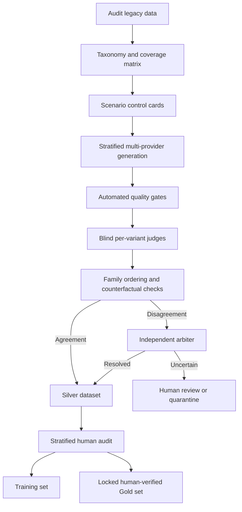

# Kế hoạch triển khai hệ thống sinh và đánh giá dữ liệu Bias Detection

## 1. Mục tiêu

Xây dựng một pipeline có thể tái lập để sinh dữ liệu synthetic chất lượng cao cho hai
domain `HR` và `Procurement`, chấm nhãn bằng nhiều AI provider độc lập, kiểm soát bằng
rule-based quality gates và duy trì một tập Gold do con người xác nhận.

Pipeline phải tạo được dữ liệu tương thích với hệ thống hiện tại, đồng thời khắc phục
các hạn chế của corpus legacy:

- Nhãn intensity không được suy ra từ chuỗi tên phiên bản.
- Các biến thể cùng scenario không được rơi vào nhiều data split khác nhau.
- Domain không được dùng thay cho bias type.
- AI generator không được tự xác nhận nhãn của chính nó.
- Mọi output phải có provenance và audit log để tái lập.

Kết quả mục tiêu của giai đoạn pilot:

- 1.000 scenario families.
- 6 severity variants cho mỗi family.
- Khoảng 6.000 dialogue variants, chưa tính hard negatives và counterfactual controls.
- Tập Silver dùng cho training và tập Gold khóa riêng dùng cho evaluation.

## 2. Phạm vi và nguyên tắc

### 2.1 Trong phạm vi

- Chuẩn hóa taxonomy và schema dữ liệu.
- Xây coverage matrix cho HR và Procurement.
- Sinh scenario family bằng nhiều model/provider.
- Chạy automated validation, cross-provider judging và arbitration.
- Human audit và tạo Gold benchmark.
- Versioning, provenance, checkpoint và resume cho batch jobs.
- Xuất dữ liệu v2 dạng JSONL để training và evaluation.

### 2.2 Ngoài phạm vi của setup ban đầu

- Gọi API production với 1.000 families ngay lập tức.
- Thay thế classifier production hiện tại.
- Đưa kết luận pháp lý theo một jurisdiction cụ thể.
- Đưa dữ liệu thật có PII của ứng viên, nhân viên hoặc supplier vào prompt.

### 2.3 Nguyên tắc thiết kế

1. **Facts first**: tạo control card có cấu trúc trước khi render hội thoại.
2. **Family consistency**: sáu mức severity dùng cùng invariant facts.
3. **Blind evaluation**: judge không thấy target label, generator hoặc provider.
4. **Cross-provider independence**: không dùng cùng provider để sinh và chấm primary.
5. **Ordinal severity**: sáu mức là bậc 0–5; phần trăm chỉ dùng để tương thích legacy.
6. **Human-grounded evaluation**: AI tạo Silver; con người xác nhận Gold.
7. **No family leakage**: split theo `family_id`, không split theo dialogue.
8. **Fail closed**: mẫu không chắc chắn được quarantine, không tự động accept.

## 3. Kiến trúc tổng thể



## 4. Taxonomy dữ liệu v2

HR và Procurement là `domain`, không phải bias type. Taxonomy được phân tầng:

```text
domain
  -> stage
    -> legacy_bias_type
      -> bias_mechanisms[]
        -> target_attributes[]
          -> severity_level
```

### 4.1 HR stages

- `job_description`
- `sourcing`
- `cv_screening`
- `interview`
- `candidate_selection`
- `compensation`
- `performance_review`
- `promotion`
- `discipline_termination`

### 4.2 HR mechanisms

- `gender_bias`
- `age_bias`
- `ethnicity_race_bias`
- `nationality_accent_bias`
- `disability_bias`
- `religion_bias`
- `pregnancy_caregiving_bias`
- `education_prestige_bias`
- `employment_gap_bias`
- `socioeconomic_bias`
- `affinity_bias`
- `culture_fit_bias`
- `halo_horns_effect`
- `confirmation_bias`
- `intersectional_bias`

### 4.3 Procurement stages

- `requirements_specification`
- `vendor_discovery`
- `prequalification`
- `rfp_creation`
- `technical_evaluation`
- `commercial_evaluation`
- `negotiation`
- `vendor_award`
- `supplier_performance`
- `renewal_termination`

### 4.4 Procurement mechanisms

- `incumbent_favoritism`
- `brand_reputation_bias`
- `company_size_bias`
- `geographic_country_bias`
- `local_foreign_preference`
- `supplier_diversity_bias`
- `affinity_relationship_bias`
- `conflict_of_interest`
- `price_anchoring`
- `confirmation_bias`
- `availability_recency_bias`
- `tailored_specifications`
- `inconsistent_risk_criteria`
- `urgency_bias`

### 4.5 Legacy compatibility

Mỗi record giữ `legacy_bias_type` thuộc 11 class hiện tại. Một `bias_mechanism` mới có
thể map về một legacy class, nhưng mapping này không thay thế mechanism label.

Ví dụ:

```json
{
  "domain": "procurement",
  "stage": "vendor_award",
  "legacy_bias_type": "4_behavioural_and_psychological",
  "bias_mechanisms": ["incumbent_favoritism", "affinity_relationship_bias"]
}
```

## 5. Severity model

Severity được lưu dưới dạng ordinal level:

| Level | Legacy % | Ý nghĩa |
|---:|---:|---|
| 0 | 0 | Không có bias; quyết định dựa trên tiêu chí liên quan và nhất quán |
| 1 | 10 | Dấu hiệu rất nhẹ hoặc framing không cân bằng nhưng chưa chi phối quyết định |
| 2 | 30 | Bias ngầm có evidence; có thể ảnh hưởng cách đánh giá |
| 3 | 50 | Bias rõ và có ảnh hưởng đáng kể tới quyết định |
| 4 | 70 | Bias mạnh; tiêu chí không liên quan lấn át tiêu chí khách quan |
| 5 | 100 | Bias trực tiếp, explicit hoặc quyết định chủ yếu dựa trên thuộc tính không phù hợp |

Model training mới nên dùng ordinal classification hoặc cumulative ordinal head. Trường
`legacy_intensity` giữ giá trị `[0.0, 0.1, 0.3, 0.5, 0.7, 1.0]` cho compatibility.

## 6. Schema chuẩn

### 6.1 Scenario control card

Control card là nguồn sự thật cho toàn bộ family:

```json
{
  "family_id": "proc_vendor_award_000123",
  "domain": "procurement",
  "stage": "vendor_award",
  "language": "en",
  "legacy_bias_type": "4_behavioural_and_psychological",
  "bias_mechanisms": ["incumbent_favoritism"],
  "target_attributes": ["prior_relationship"],
  "roles": ["procurement_manager", "evaluation_committee_member"],
  "scenario_summary": "Two qualified suppliers are evaluated for an award",
  "objective_criteria": ["technical_score", "price", "delivery", "certification"],
  "invariant_facts": [
    "Both suppliers pass mandatory certification",
    "Supplier B has the higher weighted score"
  ],
  "intended_decision": "Supplier A is preferred because it is familiar",
  "counterfactual_fields": ["supplier_name", "supplier_location", "prior_relationship"],
  "applicable_levels": [0, 1, 2, 3, 4, 5]
}
```

### 6.2 Generated variant

```json
{
  "id": "proc_vendor_award_000123_v3",
  "family_id": "proc_vendor_award_000123",
  "variant_id": "v3",
  "domain": "procurement",
  "stage": "vendor_award",
  "language": "en",
  "text": "...",
  "labels": {
    "bias_present": true,
    "severity_level": 3,
    "legacy_intensity": 0.5,
    "legacy_bias_type": "4_behavioural_and_psychological",
    "bias_mechanisms": ["incumbent_favoritism"],
    "target_attributes": ["prior_relationship"],
    "expected_evidence_spans": []
  },
  "control": {
    "objective_criteria": [],
    "invariant_facts": [],
    "decision_outcome": "..."
  },
  "provenance": {
    "generator_provider": "openai",
    "generator_model": "exact-model-id",
    "prompt_version": "generation-v2",
    "seed": 42,
    "request_id": "...",
    "raw_output_sha256": "...",
    "repair_count": 0
  }
}
```

### 6.3 Judge result

```json
{
  "record_id": "proc_vendor_award_000123_v3",
  "judge_provider": "anthropic",
  "judge_model": "exact-model-id",
  "rubric_version": "judge-variant-v2",
  "bias_present": true,
  "severity_level": 3,
  "bias_mechanisms": ["incumbent_favoritism"],
  "evidence_spans": ["we already know their team"],
  "objective_criteria_consistent": false,
  "decision_affected": true,
  "realism_score": 4,
  "confidence": 0.88,
  "reason_codes": []
}
```

## 7. Coverage matrix và sampling

Không tạo full Cartesian product một cách máy móc. Coverage config phải đánh dấu:

- `required`: cell bắt buộc.
- `optional`: cell có ích nhưng ưu tiên thấp.
- `not_applicable`: không sinh.
- `human_review_priority`: tỷ lệ human audit cao hơn.

Mỗi coverage cell được xác định bởi:

```text
domain × stage × mechanism × language × scenario_style
```

Quotas pilot:

- Cell ưu tiên cao: 10–20 families.
- Cell bình thường: 5–10 families.
- Cell hiếm/intersectional: 3–8 families nhưng audit cao hơn.
- Ba generator provider phải được phân bố tương đối đều bên trong từng cell.

Không để generator identity tương quan với domain, stage hoặc bias mechanism.

## 8. Multi-provider generation

### 8.1 Provider roles

Setup hỗ trợ ba provider adapter:

- Google Gemini
- OpenAI
- Anthropic Claude

Model ID phải đến từ environment/config, không hard-code alias marketing trong dataset.
Khi provider hỗ trợ snapshot, pin snapshot để bảo đảm reproducibility.

### 8.2 Generation unit

Một request sinh trọn một family gồm sáu variants. Điều này giúp giữ invariant facts và
giảm chi phí so với sáu request rời. Output phải theo JSON schema.

Generation prompt bắt buộc:

- Chỉ sử dụng facts trong control card.
- Không tự thêm legal conclusion.
- Giữ roles, objective criteria và factual outcome.
- Các variants chỉ khác mức độ của specified bias mechanism.
- Không đưa chuỗi nhãn như `50% bias` vào dialogue.
- Tạo ngôn ngữ tự nhiên, đa dạng nhưng không dùng PII thật.

### 8.3 Batch orchestration

Mỗi provider có adapter riêng nhưng dùng chung internal job model:

```text
prepare -> submit -> poll -> download -> normalize -> validate -> checkpoint
```

Mọi job cần:

- Deterministic `custom_id` hoặc equivalent.
- Idempotency guard.
- Retry cho transient failure.
- Partial-failure recovery.
- Checkpoint và resume.
- Token/cost accounting.
- Raw request/response lưu ngoài training output.

## 9. Automated quality gates

### 9.1 Schema gate

- JSON parse được.
- Đủ required fields.
- Enum hợp lệ.
- Sáu variant IDs không trùng.
- Severity levels đúng `[0, 1, 2, 3, 4, 5]`.

### 9.2 Family consistency gate

- Roles không đổi ngoài trường được phép.
- Objective criteria không đổi.
- Invariant facts xuất hiện hoặc không bị mâu thuẫn.
- Domain/stage không bị context bleed.
- Decision action vẫn cùng loại.

### 9.3 Content gate

- Không có label leakage như `70% bias` trong text.
- Không có API key, email, phone hoặc PII thật.
- Không rỗng và nằm trong độ dài mục tiêu.
- Evidence không chỉ là lời giải thích meta của model.

### 9.4 Duplicate gate

- Exact hash duplicate.
- Normalized text duplicate.
- Semantic near-duplicate giữa các family.
- Không loại sáu controlled variants trong cùng family chỉ vì chúng giống nhau.

### 9.5 Distribution gate

- Quotas theo domain/stage/mechanism.
- Provider balance.
- Language/style balance.
- Severity support đầy đủ.

## 10. Cross-provider judging

### 10.1 Routing

- Gemini-generated: OpenAI + Claude judge.
- OpenAI-generated: Gemini + Claude judge.
- Claude-generated: Gemini + OpenAI judge.

Provider sinh dữ liệu không làm primary judge cho dữ liệu đó.

### 10.2 Pass A — blind per-variant

- Xáo trộn thứ tự variants.
- Ẩn target level, generator model và provider.
- Judge dự đoán label và trích evidence độc lập.
- Judge không thấy output của judge còn lại.

### 10.3 Pass B — family comparative check

- So target ordering với median judge ordering.
- Kiểm tra non-decreasing severity.
- Kiểm tra neutral/extreme separation.
- Kiểm tra mechanism và evidence consistency.
- Chạy counterfactual invariance checks.

### 10.4 Acceptance rule ban đầu

- Hai judge đồng ý `bias_present`.
- Severity lệch giữa hai judge không quá một ordinal level.
- Mean absolute distance tới intended level không quá `0.5` level trên family.
- Không có severity inversion; tối đa một adjacent tie.
- Neutral được dự đoán level 0–1.
- Extreme được dự đoán level 4–5.
- Mechanism Jaccard >= 0.5.
- Evidence span tồn tại nguyên văn trong text.
- Realism score >= 4/5.

Threshold phải được hiệu chỉnh lại bằng Gold set, không coi đây là hằng số vĩnh viễn.

## 11. Arbitration, repair và quarantine

Arbiter chỉ xử lý disagreement packet sau khi hai blind judge hoàn tất. Arbiter trả về:

- `accept`
- `repair`
- `human_review`
- `reject`

Repair policy:

- Tối đa một targeted repair tổng cộng cho mỗi family.
- Chỉ truyền `reason_codes`, không truyền câu trả lời mẫu do judge viết.
- Repaired sample phải được chấm lại bằng request độc lập.
- Fail sau hai lần thì reject/regenerate từ control card.

Mọi phiên bản trước và sau repair đều được lưu trong audit log.

## 12. Counterfactual controls và hard negatives

Mỗi coverage group phải chứa:

- Counterfactual identity swap với qualification giữ nguyên.
- Hard negative có đề cập thuộc tính nhạy cảm nhưng quyết định hợp lý.
- Implicit positive không có từ khóa bias rõ ràng.
- Legitimate procurement risk áp dụng nhất quán.
- Intersectional scenario có từ hai mechanism trở lên.

Các controls giúp tránh việc classifier học shortcut như thấy `age`, `accent`, `country`
hoặc `gender` là tự động dự đoán bias.

## 13. Human validation và dataset tiers

### 13.1 Bronze

Raw generated records đã qua schema validation nhưng chưa judge. Không dùng để train.

### 13.2 Silver

Qua automated gates và AI judge consensus. Có thể dùng để train sau human audit.

### 13.3 Gold

- 100% human-verified.
- Không dùng để train hoặc đưa vào retrieval corpus.
- Khóa theo version và lưu annotation guideline.
- Bao phủ cả HR, Procurement, hard negatives và counterfactual pairs.

Pilot 6.000 dialogues:

- Human audit stratified: 600–900 dialogues.
- Gold benchmark: 400–600 dialogues.
- Oversample human review cho intersectional, disability, religion, compliance và judge disagreement.

## 14. Data split chống leakage

Gán split theo `family_id`, tốt nhất trước generation:

- Train: 70%
- Validation: 15%
- Test: 15%

Các item sau luôn ở cùng split:

- Sáu severity variants.
- Paraphrases.
- Counterfactual pair.
- Repaired versions.
- Bản dịch của cùng family.

Tập Gold được quản lý riêng và không trùng control-card template với train khi có thể.

## 15. Chỉ số đánh giá

### 15.1 Synthetic data quality

- Schema validity >= 99.5%.
- Duplicate rate < 2%.
- Controlled-fact preservation >= 98%.
- AI judge acceptance >= 85% sau calibration.
- Provider/style balance nằm trong quota tolerance.

### 15.2 Judge calibration với Gold

- Bias presence F1 >= 0.85.
- Severity weighted kappa >= 0.70.
- Mechanism macro-F1 >= 0.75.
- Evidence span validity >= 0.90.
- Báo cáo agreement theo domain và mechanism.

### 15.3 Detection model

- Presence: macro-F1, balanced accuracy, AUROC/AUPRC.
- Severity: ordinal MAE và quadratic weighted kappa.
- Mechanism: micro/macro-F1.
- Calibration: Brier score và Expected Calibration Error.
- Counterfactual severity gap và label flip rate.
- Slice metrics theo domain, stage, mechanism, severity, language và generator provider.

### 15.4 Mitigation

Kế thừa metric hiện tại và bổ sung:

- Bias reduction.
- Content similarity.
- Mechanism consistency.
- Objective-criteria preservation.
- Role/action preservation.
- Hallucination rate.
- Neutral over-rewrite rate.
- Clean mitigation rate và gamed rate.

Pinned judge hiện tại phải được snapshot trước khi retrain để baseline trước/sau có thể so sánh.

## 16. Storage layout đề xuất

```text
Code/
  data_generation/
    configs/
      coverage.yaml
      providers.example.yaml
    prompts/
      generation_v2.txt
      hard_negative_v2.txt
      counterfactual_pair_v2.txt
      judge_variant_v2.txt
      judge_family_v2.txt
      arbiter_assessment_v2.txt
      arbiter_decision_v2.txt
      repair_generation_v2.txt
    schemas/
      control_card.schema.json
      generated_family_v2.schema.json
      judge_variant_v2.schema.json
      judge_family_v2.schema.json
    runs/                    # gitignored runtime artifacts
      <run_id>/
        manifest.json
        control_cards.jsonl
        requests/
        raw_responses/
        bronze.jsonl
        silver.jsonl
        rejected.jsonl
        audit_log.jsonl
        metrics.json
  src/
    data_generation/
      cli.py
      config.py
      models.py
      validators.py
      coverage.py
      providers/
      orchestration/
  tests/
    data_generation/
```

Không commit raw API output, secrets hoặc dataset generation runs lớn.

## 17. Security, privacy và governance

- API keys chỉ đọc từ environment variables.
- Không log hoặc ghi key vào manifest.
- Không dùng dữ liệu thật chứa PII trong pilot.
- Ghi provider/model/prompt version vào provenance.
- Ghi terms/policy review date cho từng provider trong run manifest.
- Dataset card phải nêu rõ dữ liệu là synthetic và AI-judged.
- `fairness` và `legal_compliance` là hai dimension riêng; không để model tự kết luận vi phạm pháp luật.

## 18. Lộ trình triển khai

### Phase 0 — Baseline freeze

- Audit corpus hiện tại.
- Snapshot pinned judge hiện tại.
- Lưu baseline metrics.

### Phase 1 — Schema và dry-run

- Tạo schemas, coverage config và prompt templates.
- Sinh deterministic local fixtures không gọi API.
- Chạy validators và export sample JSONL.

### Phase 2 — Provider pilot

- Cấu hình từng provider.
- Chạy 3–5 families/provider.
- Xác minh structured output, retry, checkpoint và cost logs.

### Phase 3 — Calibration pilot

- Sinh 100 families.
- Blind judge và human audit.
- Điều chỉnh rubric/threshold.

### Phase 4 — Full pilot

- Sinh 1.000 families.
- Tạo Silver/Gold dataset.
- Báo cáo coverage, agreement và failure modes.

### Phase 5 — Model integration

- Viết v2 loader đọc explicit labels.
- Group split theo family.
- Train baseline và multi-task model.
- Đánh giá trên locked Gold/challenge set.

## 19. Definition of Done cho setup

Setup ban đầu hoàn thành khi:

- Có schema và config mẫu được version control.
- CLI kiểm tra môi trường mà không lộ secrets.
- CLI tạo deterministic dry-run family.
- Validators phát hiện schema lỗi, label leakage và family inconsistency.
- Provider interface tách biệt khỏi orchestration.
- Có batch request builder/checkpoint contract.
- Tests chạy offline thành công.
- README có lệnh setup, dry-run và bước cấu hình API keys.
- Runtime artifacts và secrets được gitignore.

## 20. Quyết định trước khi chạy production batch

Chỉ chạy 1.000 families sau khi:

1. Dry-run và provider smoke tests đều pass.
2. Pilot 100 families đạt schema validity và fact-preservation targets.
3. AI judge đạt agreement mục tiêu trên human-reviewed subset.
4. Coverage report không có cell ưu tiên bị thiếu.
5. Token/cost budget và retry policy được xác nhận.
6. Gold split được khóa trước khi training.

## 21. Prompt contract v2 và cổng chất lượng 85%

`generation_v2` là prompt mặc định; các file v1 chỉ được giữ để tái lập lịch sử. Prompt v2
không chỉ yêu cầu “tăng mức bias”, mà neo từng level vào bốn dấu hiệu quan sát được:
framing/ngôn ngữ, mức độ scrutiny, tính nhất quán khi dùng tiêu chí, và quan hệ nhân quả với
quyết định. Level 0-2 không được khai rằng bias làm thay đổi quyết định; level 3-5 phải có
causal evidence ngày càng rõ. Tone thô hơn, đứng riêng, không đủ để tăng severity.

Generator phải trả thêm `decision_outcome`, tiêu chí đã dùng hoặc làm sai lệch,
`mechanism_manifestation`, kiểm tra từng invariant fact và evidence span nguyên văn. Nếu
control card mâu thuẫn, generator phải trả structured failure thay vì tự bịa dữ kiện. HR có
guardrail riêng cho essential functions/accommodation; Procurement có guardrail riêng để
phân biệt risk/compliance hợp lệ với country, brand, incumbent, size và price proxy.

Judge v2 là blind: không thấy target level, generator/provider hoặc evidence do generator đề
xuất. Variant judge bắt buộc kiểm tra causal link, legitimate alternative, evidence strength,
counterfactual outcome, fact preservation và uncertainty. Family judge nhận ID opaque đã xáo
trộn, tự xếp hạng từ thấp đến cao; chương trình mới map kết quả về target levels. Arbiter được
tách thành hai request: đánh giá blind được niêm phong, sau đó mới so với hai judge result.

Các ngưỡng release được cấu hình tại `quality_thresholds.yaml`:

- calibration pilot tối thiểu 100 families;
- pre-judge automated pass rate tối thiểu 90%;
- tối đa một targeted repair cho mỗi family;
- Silver acceptance rate tối thiểu 85%;
- thiếu sample hoặc thấp hơn ngưỡng thì dừng batch, phân tích theo domain, stage, provider,
  coverage cell và reason code rồi mới sửa prompt/control card.

Mốc 85% là acceptance gate đo trên pilot, không phải lời đảm bảo trước khi gọi provider. Chỉ
mở rộng lên 1.000 families khi pilot thực tế vượt gate và human audit xác nhận judge không đạt
tỷ lệ cao bằng cách accept sai.
